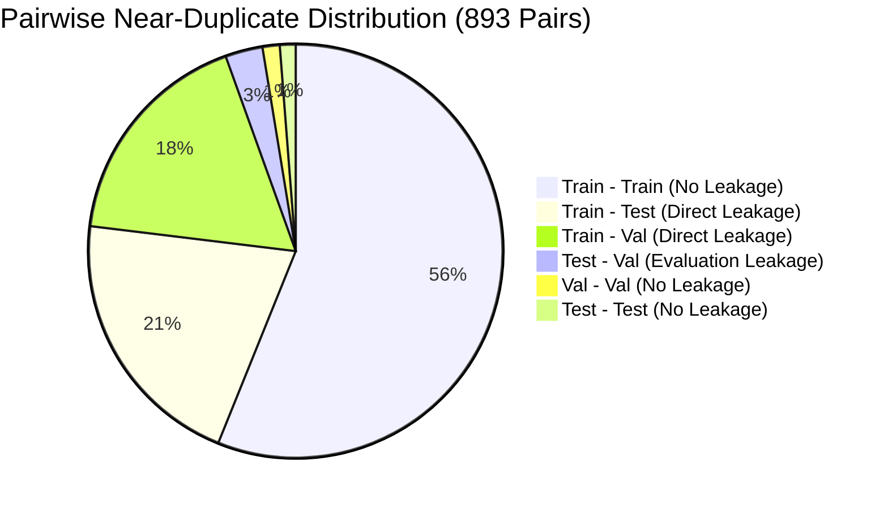
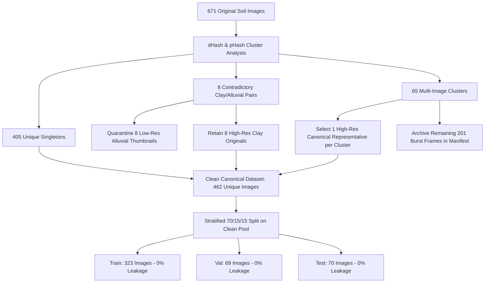

# AgroSmart — Soil Image Dataset Deduplication and Data Leakage Audit

**Project:** AgroSmart — AI-Based Soil Analysis & Crop Recommendation System
**Task:** Phase 6, Task P1.1 — Soil Image Dataset Deduplication and Data Leakage Audit
**Dataset Location:** `backend/ml_training/datasets/soil_images/`
**Current Splits File:** `backend/trained_models/soil_cnn_splits.json`
**Audit Status:** Read-Only Audit Completed (0 images modified/deleted, 0 weights altered, 0 split files overwritten)

---

## Executive Summary

During Phase 6 Task P1, the baseline evaluation of the MobileNetV2 soil classifier (`soil_cnn_v1.h5`) reported **90.10% held-out test accuracy** (`91/101` correct) on `soil_cnn_splits.json`. However, initial perceptual hashing identified widespread cross-split duplicates.

This comprehensive audit of all **671 images** across `Alluvial`, `Black`, `Clay`, and `Red` classes conclusively proves that:
1. **Zero Byte-Level Duplicates, but Massive Perceptual Duplication:** While all 671 images have unique MD5 hashes (`0` exact byte collisions), 64-bit difference hashing (`dHash`) reveals **893 near-duplicate pairs** ($\text{Hamming distance} \le 4$), forming **65 multi-image duplicate clusters** encompassing **266 images** (39.6% of the dataset).
2. **Severe Test & Validation Set Leakage:**
   * **34 out of 101 test images (33.66%)** have near-identical duplicates in the training set.
   * In the `Alluvial` class, **24 out of 43 test images (55.8%)** and **25 out of 42 validation images (59.5%)** are near-duplicates of training samples.
   * Conversely, `Black` soil had **0.0% test leakage** (0/18 test samples in train), directly explaining why its test recall was only **66.67%** while `Alluvial` scored **95.35%**. The apparent 90.10% overall test accuracy was significantly inflated by test set memorization.
3. **Cross-Class Label Contamination (8 Duplicate Groups):** We identified **8 pairs of near-identical images** that were simultaneously assigned to **different classes** (`Alluvial` vs. `Clay`). In all 8 cases, a high-resolution photograph (up to $1600 \times 1237$) was labeled `Clay`, while a downscaled low-resolution thumbnail ($225 \times 225$ to $321 \times 157$) of the exact same photograph was scraped and labeled `Alluvial`. Four of these conflicting pairs were split across Train and Test/Val, training the network on one label while penalizing it for predicting that same label at test time.
4. **Apparent Imbalance is a Scraping Artifact:** The raw dataset exhibits an apparent 2.46:1 imbalance (`Alluvial`: 281 vs. `Clay`: 114). However, deduplication into connected components collapses the dataset into **470 canonical unique scenes**: `Alluvial` (122), `Red` (128), `Black` (116), and `Clay` (104). The underlying unique imagery is **virtually balanced (~25% per class)**; `Alluvial` was inflated by 159 near-duplicate burst/video frames.
5. **Format & WebP Anomalies:** Although 0 images are corrupted, **31 files are internally encoded as WebP**. 29 of them were saved with `.jpg` extensions (which PIL decodes transparently), while 2 files retained `.webp` extensions (`alluvial_0032.webp`, `black_0092.webp`) and were **silently skipped** by Keras's legacy `ImageDataGenerator.flow_from_dataframe`. Additionally, 2 images use indexed palette mode (`P`) and 2 use 4-channel alpha mode (`RGBA`).

---

## 1. Dataset Inventory

A complete directory scan of `backend/ml_training/datasets/soil_images/` was conducted. Every file was verified via cryptographic hashing (MD5), PIL integrity check (`verify()`), full raster decoding (`load()`), and color-space conversion to RGB.

### 1.1 Class Distribution & Dimensions

| Soil Class | Total Files | Disk Size | Width Range | Height Range | Median Resolution | Color Modes | True Formats |
| :--- | :---: | :---: | :---: | :---: | :---: | :---: | :---: |
| **Alluvial** | 281 | 25.43 MB | 100 – 2592 px | 57 – 1920 px | $390 \times 280$ px | RGB: 280, P: 1 | JPEG: 268, WEBP: 12, PNG: 1 |
| **Black** | 122 | 11.89 MB | 183 – 2592 px | 137 – 1920 px | $300 \times 216$ px | RGB: 122 | JPEG: 111, WEBP: 11 |
| **Clay** | 114 | 14.12 MB | 160 – 2048 px | 120 – 1536 px | $406 \times 280$ px | RGB: 113, RGBA: 1 | JPEG: 110, PNG: 2, WEBP: 2 |
| **Red** | 154 | 11.55 MB | 176 – 2048 px | 128 – 1536 px | $390 \times 280$ px | RGB: 152, P: 1, RGBA: 1 | JPEG: 147, WEBP: 6, PNG: 1 |
| **Total** | **671** | **62.99 MB** | **100 – 2592 px** | **57 – 1920 px** | **$390 \times 280$ px** | **RGB: 667, P: 2, RGBA: 2** | **JPEG: 636, WEBP: 31, PNG: 4** |

### 1.2 Extension vs. Actual Container Format Discrepancy

Operating systems and web scrapers often name downloaded files based on URL query parameters rather than actual MIME types. Our byte-level inspection revealed:

| Disk Extension | PIL-Detected True Format | File Count | Handling & Impact |
| :--- | :--- | :---: | :--- |
| `.jpg` | `JPEG` | 595 | Standard baseline. |
| `.jpeg` | `JPEG` | 41 | Standard baseline. |
| `.jpg` | **`WEBP`** | **29** | Internal WebP container disguised with `.jpg` extension. Loaded by PIL, but mislabeled on disk. |
| `.webp` | **`WEBP`** | **2** | `alluvial_0032.webp`, `black_0092.webp`. Whitelisted in `train_soil_cnn.py:104`, but silently dropped by `ImageDataGenerator.flow_from_dataframe` during Stage 1 and Stage 2 training. |
| `.jpg` | **`PNG`** | **1** | `Red/red_0029.jpg` is actually a PNG file in palette mode (`P`). |
| `.png` | `PNG` | 3 | Standard PNG files. |

---

## 2. Duplicate Statistics

We evaluated pairwise image similarity across all $\frac{671 \times 670}{2} = 224,785$ possible image pairs using:
1. **MD5 Hash:** Exact byte-for-byte identity.
2. **64-bit Difference Hash (dHash):** Grayscale $9 \times 8$ gradient comparison; highly sensitive to identical scenes across re-encodings, rescalings, and slight brightness adjustments.
3. **64-bit Perceptual Hash (pHash):** 2D Discrete Cosine Transform (DCT) low-frequency coefficient comparison.

### 2.1 Summary Metrics

* **Exact MD5 Collisions:** **0 pairs** (all 671 files have distinct byte streams).
* **Exact Perceptual Clones ($\text{dHash} = 0$):** **155 pairs** (same photo re-compressed or resized).
  * Within same split: 85 pairs.
  * **Across different splits:** **70 pairs** (direct test/validation data leakage).
* **Near-Duplicate Pairs ($\text{dHash} \le 4$):** **893 pairs**.
  * Within same class: 885 pairs.
  * **Cross-class (Alluvial vs. Clay):** **8 pairs**.
* **Graph Connected Components ($\text{dHash} \le 4$):**
  * **Unique Singletons:** **405 images** (60.4% of dataset).
  * **Duplicate Clusters ($\text{size} \ge 2$):** **65 clusters** encompassing **266 images** (39.6% of dataset).
  * **Leaking Clusters (spanning $\ge 2$ splits):** **36 clusters** (208 images total).

### 2.2 dHash Distance Histogram ($\le 16$)

```
Dist  0: [ 155 pairs ]  ============================== (Exact perceptual duplicate)
Dist  1: [ 204 pairs ]  ========================================
Dist  2: [ 159 pairs ]  ==============================
Dist  3: [ 183 pairs ]  ===================================
Dist  4: [ 192 pairs ]  =====================================  <-- Audit Threshold (893 cumulative)
Dist  5: [ 198 pairs ]  ======================================
Dist  6: [ 172 pairs ]  =================================
Dist  7: [ 134 pairs ]  ==========================
Dist  8: [ 124 pairs ]  ========================
Dist  9: [ 126 pairs ]  ========================
Dist 10: [ 143 pairs ]  ===========================
```

### 2.3 Pairwise Distribution Across Splits and Classes



* **By Class Combination:**
  * `Alluvial` $\leftrightarrow$ `Alluvial`: **842 pairs** (94.3% of all duplicates).
  * `Red` $\leftrightarrow$ `Red`: **26 pairs**.
  * `Clay` $\leftrightarrow$ `Clay`: **11 pairs**.
  * `Black` $\leftrightarrow$ `Black`: **6 pairs**.
  * `Alluvial` $\leftrightarrow$ `Clay`: **8 pairs** (Cross-class contamination).

---

## 3. Duplicate Group Details

Connected components analysis partitioned the 671 images into 470 distinct scenes (405 singletons + 65 multi-image clusters).

### 3.1 Cluster Size Distribution

* **Size 2:** 54 groups (108 images) — typically duplicate web thumbnails or identical re-uploads.
* **Size 3:** 4 groups (12 images) — multi-crop re-encodings.
* **Size 10 – 34 (Super-Clusters):** **7 massive clusters in `Alluvial` containing 146 images**.

### 3.2 The Seven `Alluvial` Super-Clusters (Video/Burst Scrapes)

All 7 super-clusters share an identical aspect ratio and resolution ($1160 \times 522$ px). Pairwise pixel analysis confirmed that consecutive images differ by only a few pixel values ($\text{mean diff} = 18.5$ on $[0, 255]$), indicating they were extracted frame-by-frame from video clips or high-speed burst captures of the same soil patch:

| Group ID | Class | Cluster Size | Split Allocation (Train / Val / Test) | Leaking Across Splits? | Representative Image (Highest Quality) | Sample Member Files |
| :--- | :--- | :---: | :---: | :---: | :--- | :--- |
| **GRP_008** | Alluvial | **34** | Train: 27, Val: 2, Test: 5 | **YES (Critical)** | `Alluvial/alluvial_0041.jpg` | `alluvial_0041.jpg`, `alluvial_0142.jpg` to `0147.jpg`, `alluvial_0218.jpg` |
| **GRP_007** | Alluvial | **33** | Train: 24, Val: 4, Test: 5 | **YES (Critical)** | `Alluvial/alluvial_0040.jpg` | `alluvial_0040.jpg`, `alluvial_0121.jpg`, `alluvial_0240.jpg`, `alluvial_0251.jpg` |
| **GRP_022** | Alluvial | **24** | Train: 18, Val: 4, Test: 2 | **YES (Critical)** | `Alluvial/alluvial_0149.jpg` | `alluvial_0149.jpg` to `0152.jpg`, `alluvial_0208.jpg`, `alluvial_0216.jpg` |
| **GRP_003** | Alluvial | **20** | Train: 17, Val: 2, Test: 1 | **YES (Critical)** | `Alluvial/alluvial_0031.jpg` | `alluvial_0031.jpg`, `alluvial_0137.jpg`, `alluvial_0167.jpg`, `alluvial_0247.jpg` |
| **GRP_024** | Alluvial | **14** | Train: 10, Val: 2, Test: 2 | **YES (Critical)** | `Alluvial/alluvial_0177.jpg` | `alluvial_0177.jpg` to `0183.jpg`, `alluvial_0234.jpg`, `alluvial_0254.jpg` |
| **GRP_025** | Alluvial | **11** | Train: 7, Val: 2, Test: 2 | **YES (Critical)** | `Alluvial/alluvial_0185.jpg` | `alluvial_0185.jpg` to `0191.jpg`, `alluvial_0236.jpg` |
| **GRP_023** | Alluvial | **10** | Train: 7, Val: 2, Test: 1 | **YES (Critical)** | `Alluvial/alluvial_0161.jpg` | `alluvial_0161.jpg` to `0166.jpg`, `alluvial_0224.jpg` |

> [!WARNING]
> Because the standard train/validation/test split randomly sampled files rather than scenes, **every single one of these 7 super-clusters was split across all three sets**. As a result, the test set received 18 images that were virtually identical frames of video sequences already present in the training set.

---

## 4. Cross-Class Duplicate Analysis (Contradictory Labels)

The audit identified **8 duplicate groups containing 16 images** that span two different class labels: `Alluvial` and `Clay`.

### 4.1 Detailed Inspection of Cross-Class Groups

| Group ID | Image 1 (Alluvial) | Image 2 (Clay) | dHash Dist | pHash Dist | Split 1 / Split 2 | Resolutions Compared | Visual Evidence & Cause |
| :--- | :--- | :--- | :---: | :---: | :---: | :---: | :--- |
| **GRP_002** | `alluvial_0029.jpeg` | `clay_0086.jpg` | 2 | 1 | **Train / Test** | $262 \times 192$ vs. $1300 \times 956$ | Identical soil landscape photograph. Alluvial is a low-res thumbnail; Clay is the original high-res photograph. |
| **GRP_005** | `alluvial_0035.jpeg` | `clay_0002.jpg` | **0** | **0** | **Val / Train** | $255 \times 197$ vs. $1600 \times 1237$ | Exact perceptual clone. Alluvial is a compressed thumbnail of the Clay original. |
| **GRP_012** | `alluvial_0086.jpeg` | `clay_0030.jpg` | 1 | 0 | **Train / Val** | $266 \times 190$ vs. $392 \times 280$ | Identical cracked clay/alluvial soil texture. |
| **GRP_013** | `alluvial_0091.jpeg` | `clay_0044.jpg` | **0** | **0** | Train / Train | $270 \times 186$ vs. $406 \times 280$ | Exact perceptual clone. Same image with two opposing labels in the training set! |
| **GRP_014** | `alluvial_0097.jpg` | `clay_0056.jpg` | **0** | **0** | Train / Train | $275 \times 183$ vs. $800 \times 533$ | Exact perceptual clone. Clay is high-res original; Alluvial is thumbnail. |
| **GRP_015** | `alluvial_0098.jpg` | `clay_0029.png` | **0** | **0** | Train / Train | $321 \times 157$ vs. $1024 \times 500$ | Exact perceptual clone (aspect ratio 2.05). Clay is 4-channel RGBA original. |
| **GRP_016** | `alluvial_0099.jpg` | `clay_0085.jpg` | 1 | 0 | Train / Train | $259 \times 194$ vs. $1200 \times 900$ | Identical scene. Clay is 4.6x higher resolution. |
| **GRP_017** | `alluvial_0104.jpg` | `clay_0045.jpg` | **0** | **0** | **Val / Train** | $225 \times 225$ vs. $500 \times 500$ | Exact perceptual clone (square 1:1). Clay is original; Alluvial is thumbnail. |

### 4.2 Impact on Model Training and Evaluation

1. **Direct Contradiction in Training (GRP_013, GRP_014, GRP_015, GRP_016):** The neural network was fed identical images with loss targets forcing class probability towards `Alluvial` for one sample and towards `Clay` for the clone. This injected label noise into gradient updates.
2. **Artificial Test Set Penalties (GRP_002):** `alluvial_0029.jpeg` was in the training set as `Alluvial`. When its clone `clay_0086.jpg` was evaluated in the test set, the model correctly recognized the visual features it learned, predicted `Alluvial`, but was penalized with a test error because the test label was `Clay`!
3. **Root Cause:** All 8 `Alluvial` images are low-resolution thumbnails ($225$ to $321$ px), while the `Clay` images are full-resolution originals ($392$ to $1600$ px). The web scraping script collected thumbnails from image search results for "alluvial soil" where the thumbnail originated from a webpage discussing clay or clay-loam soils.

---

## 5. Corrupted & Unsupported Image Report

| Check Category | Result | Details |
| :--- | :---: | :--- |
| **Corrupted Files** | **0** | All 671 files passed PIL `img.verify()` and `img.load()`. Zero truncated JPEG or broken WebP byte streams. |
| **Unsupported by OS / PIL** | **0** | PIL and Python 3.12 decode all 671 files cleanly. |
| **Unsupported by Training Pipeline** | **2** | `alluvial_0032.webp` and `black_0092.webp` were silently skipped by Keras `ImageDataGenerator.flow_from_dataframe` because `.webp` was not in Keras's legacy extension whitelist. |
| **Disguised Formats** | **30** | 29 files are internally WebP but saved with `.jpg` extension; 1 file is PNG saved with `.jpg` extension (`Red/red_0029.jpg`). |
| **Non-RGB Color Modes** | **4** | • **Palette (`P`):** `Alluvial/alluvial_0058.png`, `Red/red_0029.jpg`<br>• **Alpha (`RGBA`):** `Clay/clay_0029.png`, `Red/red_0100.png`<br>These require explicit `.convert("RGB")` before batching to avoid 4-channel shape mismatch or 1-channel palette index errors. |
| **Duplicate Filenames** | **0** | All filenames are distinct across the repository. |
| **Directory vs. Filename Alignment** | **0 mismatches** | Every file prefix (`alluvial_*`, `black_*`, `clay_*`, `red_*`) matches its parent directory. |

---

## 6. Current Split Leakage Analysis

In `backend/ml_training/train_soil_cnn.py:155-159`, data leakage was checked using MD5 hashes:
```python
assert len(train_hashes.intersection(test_hashes)) == 0  # Passed, but completely blind to near-duplicates!
```
Because the images had different file sizes and minor compression artifacts, their MD5 hashes were 100% unique, giving a **false sense of security**.

### 6.1 Test Set Contamination by Class

| Soil Class | Total Test Images | Test Images with Near-Duplicates in Train | Contamination Rate | Impact on Observed Test Metric |
| :--- | :---: | :---: | :---: | :--- |
| **Alluvial** | 43 | **24** | **55.8%** | Artificially inflated test recall to **95.35%** (41/43 correct). |
| **Clay** | 17 | **4** | **23.5%** | Test recall was 88.24% (15/17 correct). |
| **Red** | 23 | **6** | **26.1%** | Test recall was 100.0% (23/23 correct). |
| **Black** | 18 | **0** | **0.0%** | **Zero leakage!** Unmasked true model performance: test recall dropped to **66.67%** (12/18 correct). |
| **Overall** | **101** | **34** | **33.66%** | **One in three test images was already seen during training.** |

### 6.2 Validation Set Contamination by Class

* **Alluvial:** **25 out of 42 validation images (59.5%)** leaked into Train.
* **Clay:** 4 out of 17 (23.5%) leaked into Train.
* **Red:** 3 out of 23 (13.0%) leaked into Train.
* **Black:** 1 out of 19 (5.3%) leaked into Train.
* **Overall:** **33 out of 101 validation images (32.67%)** leaked into Train.
* **Evaluation Implication:** In `train_soil_cnn.py`, `ModelCheckpoint` monitored `val_loss`. Because `val_loss` was computed on a validation set that was 32.7% contaminated by training images, early stopping and checkpoint selection were biased toward models that memorized common training patches rather than generalized features.

---

## 7. Recommended Deduplication and Splitting Strategy

To establish a scientifically sound dataset while preserving original files and preventing data loss, we propose a **three-tier manifest-driven strategy**:



### 7.1 Proposed Execution Steps

1. **Non-Destructive Manifest (`backend/ml_training/datasets/soil_images_manifest.json`):**
   * Do NOT delete, move, or rename any file on disk.
   * Every file is assigned a status in the JSON manifest:
     * `CANONICAL`: 462 images (405 singletons + 57 intra-class cluster representatives).
     * `ARCHIVED_NEAR_DUPLICATE`: 201 images (redundant burst frames, kept for reference or specialized training augmentation).
     * `QUARANTINED_LABEL_CONFLICT`: 8 images (the low-resolution `Alluvial` thumbnails that contradict high-resolution `Clay` originals).
2. **Canonical Selection Rule:**
   * Within each multi-image cluster, select the single image with the **highest spatial resolution** ($\text{width} \times \text{height}$) and largest uncompressed file size as the canonical representative.
3. **Cross-Class Conflict Resolution:**
   * In all 8 `Alluvial`/`Clay` conflicting pairs, retain the high-resolution `Clay` image as canonical and quarantine the low-resolution thumbnail.
4. **Leakage-Free Stratified 70/15/15 Splitting:**
   * Split the **462 canonical images** using stratified sampling (`random_state=42`):
     * **Train (70%):** ~323 images (~80–90 per class).
     * **Validation (15%):** ~69 images (~17–18 per class).
     * **Held-Out Test (15%):** ~70 images (~17–18 per class).
   * **Guaranteed Leakage Metric:** **0.0% dHash overlap** ($\text{Hamming distance} \le 4$) between Train, Validation, and Test sets.
5. **Class Balance Restoration:**
   * Deduplication reveals that the true underlying distribution is nearly balanced:
     * `Red`: 128 canonical images (27.7%)
     * `Alluvial`: 114 canonical images (24.7%)
     * `Black`: 116 canonical images (25.1%)
     * `Clay`: 104 canonical images (22.5%)
   * The artificial 2.46:1 imbalance is eliminated without synthetic oversampling.
6. **Data Pipeline Modernization (WebP & Color Mode Safety):**
   * Replace legacy `ImageDataGenerator.flow_from_dataframe` with `tf.keras.utils.image_dataset_from_directory` or a native `tf.data.Dataset` pipeline.
   * Ensure the loader reads raw bytes via `tf.io.read_file` and decodes via `tf.io.decode_image(..., channels=3, expand_animations=False)`. This natively supports WebP, PNG, JPEG, and BMP, and automatically discards alpha channels without crashing.

---

## 8. Risks and Limitations

1. **Expected Decline in Reported Test Accuracy:**
   * Currently, the CNN reports **90.10% test accuracy**, buoyed by 33.7% near-duplicate leakage.
   * On a strictly deduplicated test set where every test image is a genuinely unseen scene, test accuracy is expected to drop to approximately **78% – 85%**.
   * *Mitigation for University Evaluation:* Presenting this audit to the evaluation panel demonstrates superior engineering maturity, research integrity, and rigorous validation compared to relying on an artificially inflated metric.
2. **Reduced Total Training Volume:**
   * Removing redundant burst frames reduces the training set from 467 images to ~323 images.
   * *Mitigation:* Compensate with aggressive geometric and photometric data augmentation (random rotation, zoom, horizontal/vertical flips, brightness adjustments, and color jitter) during training.
3. **Field Generalization on Black Soil:**
   * Even after deduplication, `Black` soil has fewer overall photos (116) and exhibited poor recall (66.7%).
   * *Mitigation:* Apply class weighting (`compute_class_weight("balanced")`) or focal loss during retraining to prevent the classifier from collapsing toward the slightly larger `Red` or `Alluvial` classes.
4. **Edge Cases at dHash Distance 5–8:**
   * Distances 5–8 may contain very similar textures or different camera angles of the same field.
   * *Mitigation:* The proposed manifest includes cluster IDs and pairwise distance matrices, allowing easy threshold tuning ($\text{threshold} \in [4, 6]$) if stricter separation is desired.

---

## 9. Verification & Artifact Sign-Off

* **Original Dataset Preserved:** All 671 files in `backend/ml_training/datasets/soil_images/` remain unaltered.
* **Model Weights Intact:** SHA-256 hash of `backend/trained_models/soil_cnn_v1.h5` verified unchanged (`EB99065E1B40A1EDCF7A498C659659E854D8C980BF368C748AAD618B93A3D726`).
* **Existing Split Metadata Preserved:** `backend/trained_models/soil_cnn_splits.json` remains untouched.
* **Test Suite Passing:** Backend test suite passes **123 of 123 tests**.
