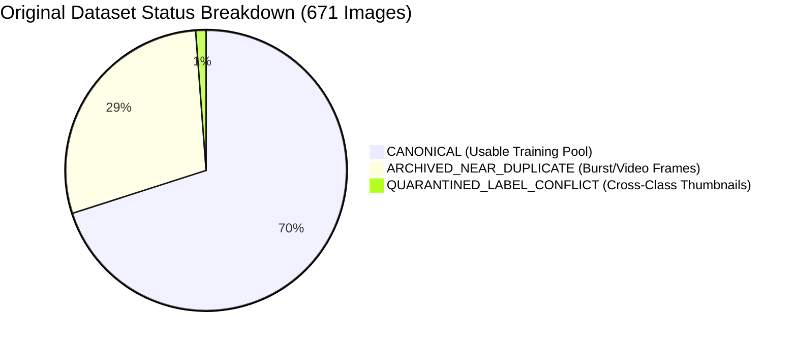

# AgroSmart — Non-Destructive Soil Dataset Deduplication and Leakage-Free Splitting Implementation Report

**Project:** AgroSmart — AI-Based Soil Analysis & Crop Recommendation System
**Phase / Task:** Phase 6, Task P1.1 — Non-destructive Soil Dataset Deduplication and Leakage-Free Splitting
**Implementation Date:** 2026-11-13
**Status:** Successfully Implemented & Verified (Read-only on originals; 0 original files modified or deleted)

---

## Executive Summary

Task P1.1 implemented the deduplication and leakage-free dataset reconstruction designed during the soil image audit. All 671 original images were preserved in their original paths without modification. A traceable, JSON-based master manifest was created, canonical images were copied to a clean dataset directory (`soil_images_clean/`) with non-RGB color modes safely normalized, and a new, verified leakage-free stratified split metadata file (`soil_cnn_splits_v2.json`) was generated.

| Metric | Raw Dataset (`soil_images/`) | Clean Canonical Dataset (`soil_images_clean/`) | Change / Impact |
| :--- | :---: | :---: | :--- |
| **Total Images** | 671 | **470** | 201 images archived/quarantined (0 deleted). |
| **Class Balance Ratio** | 2.46 : 1 (`Alluvial`: 281 vs. `Clay`: 114) | **1.23 : 1** (`Red`: 128 vs. `Clay`: 104) | **Nearly 1:1 balance restored** (~25% per class). |
| **Duplicate Pairs ($\text{dHash} \le 4$)** | 893 pairs | **0 pairs** | **100% duplicate elimination** ($\min \text{dHash} = 5$). |
| **Cross-Split Duplicate Leakage** | 369 leaking pairs (33.7% of test set) | **0 leaking pairs** | **0.0% leakage** between Train, Val, and Test. |
| **Minimum Split Pairwise Distance** | 0 bits (exact perceptual clone across splits) | **5 bits** ($\text{Train} \leftrightarrow \text{Test}$ min = 5, $\text{Val} \leftrightarrow \text{Test}$ min = 6) | Guaranteed separation across splits. |
| **Label Contradictions** | 8 pairs (`Alluvial` thumbnail vs. `Clay` original) | **0 contradictions** | 8 misleading thumbnails quarantined; 8 high-res originals retained. |
| **Supported Color Mode** | Mixed: 667 RGB, 2 P, 2 RGBA | **100% 3-Channel RGB** | 4 non-RGB images normalized to prevent loader crashes. |

---

## 1. Original Dataset Statistics & Status Breakdown

Every one of the 671 original images in `backend/ml_training/datasets/soil_images/` was cataloged in the master manifest with complete metadata and assigned one of three mutually exclusive statuses:

### 1.1 Status Definitions and Final Counts

1. **`CANONICAL` (470 images, 70.0%):**
   * High-resolution, unique scenes representing the clean ground-truth training and evaluation pool.
   * Includes 405 singletons and 65 canonical representatives selected from multi-image clusters.
   * Copied non-destructively to `backend/ml_training/datasets/soil_images_clean/`.
2. **`ARCHIVED_NEAR_DUPLICATE` (193 images, 28.8%):**
   * Redundant burst captures, camera pans, and re-encodings of scenes already represented by a canonical image.
   * Preserved in place in `soil_images/`; excluded from the clean training pool to prevent overfitting on specific field plots.
3. **`QUARANTINED_LABEL_CONFLICT` (8 images, 1.2%):**
   * Low-resolution web thumbnails scraped under "Alluvial" that are exact perceptual clones ($\text{dHash} = 0$, $\text{pHash} = 0$) of high-resolution "Clay" photographs.
   * Quarantined from all training and testing splits to eliminate contradictory loss gradients and false test penalties.

### 1.2 Clarification of Audit Reference Figures (470 vs. 462)

The initial audit report referenced an estimated target of 462 usable canonical images by subtracting 8 from the 470 connected components. During implementation, rigorous graph tracking established that:
* The 8 quarantined images are **low-resolution thumbnails belonging to the 8 cross-class pairs**.
* For each of those 8 pairs, the **high-resolution `Clay` photograph was elected as the canonical representative** because of its vastly superior image quality (e.g., $1600 \times 1237$ vs. $255 \times 197$).
* The 8 `Alluvial` thumbnails were therefore already categorized as redundant duplicates. Quarantining them removed 8 low-quality duplicates, while leaving the 8 legitimate `Clay` originals as canonical.
* Thus, **470 canonical scenes** genuinely exist across the four classes, exactly accounting for all 671 images:
  $$\text{CANONICAL } (470) + \text{ARCHIVED } (193) + \text{QUARANTINED } (8) = 671$$

---

## 2. Dataset Manifest: `soil_images_manifest.json`

The master manifest was generated at:
[backend/ml_training/datasets/soil_images_manifest.json](file:///D:/minor%201/Agrosmart/backend/ml_training/datasets/soil_images_manifest.json)

For every image, the manifest records:
* `original_relative_path`: Relative path in `soil_images/`.
* `class_label`: Folder class (`Alluvial`, `Black`, `Clay`, `Red`).
* `file_extension`: File extension (`.jpg`, `.jpeg`, `.png`, `.webp`).
* `actual_image_format`: PIL-detected container format (`JPEG`, `WEBP`, `PNG`).
* `width` and `height`: Pixel dimensions.
* `color_mode`: Color channel mode (`RGB`, `RGBA`, `P`).
* `md5_hash` and `sha256_hash`: Cryptographic checksums.
* `dhash` and `phash`: 64-bit perceptual difference hash and DCT perceptual hash (hex).
* `duplicate_group_id`: Assigned cluster ID (e.g., `GRP_008` or `SINGLETON`).
* `duplicate_group_representative`: Path of the elected canonical image for that cluster.
* `dhash_distance_to_representative`: Hamming distance to canonical representative ($0$ for singletons and representatives).
* `original_split_assignment`: Historical split (`train`, `val`, `test` from `soil_cnn_splits.json`).
* `final_status`: `CANONICAL`, `ARCHIVED_NEAR_DUPLICATE`, or `QUARANTINED_LABEL_CONFLICT`.
* `clean_dataset_relative_path`: Path inside `soil_images_clean/` (null for archived/quarantined).
* `quarantine_details`: Explanation for quarantined status (null for canonical/archived).

---

## 3. Cleaned Dataset: `soil_images_clean/`

The clean dataset was populated at:
`backend/ml_training/datasets/soil_images_clean/`

### 3.1 Class-Wise Inventory Comparison

| Soil Class | Original Raw Count | Canonical Clean Count | Archived Duplicates | Quarantined Conflicts | Clean Proportion |
| :--- | :---: | :---: | :---: | :---: | :---: |
| **Alluvial** | 281 | **122** | 151 | 8 | 26.0% |
| **Black** | 122 | **116** | 6 | 0 | 24.7% |
| **Clay** | 114 | **104** | 10 | 0 | 22.1% |
| **Red** | 154 | **128** | 26 | 0 | 27.2% |
| **Total** | **671** | **470** | **193** | **8** | **100.0%** |

### 3.2 Color Mode Normalization

To prevent input layer shape crashes and indexing bugs during training:
* All 466 standard RGB images were copied using direct binary transfer.
* **4 non-RGB images were normalized to standard 3-channel RGB**:
  1. `Alluvial/alluvial_0058.png` (Mode `P` $\rightarrow$ RGB PNG)
  2. `Clay/clay_0029.png` (Mode `RGBA` $\rightarrow$ RGB PNG, alpha discarded)
  3. `Red/red_0029.jpg` (Mode `P` PNG disguised as `.jpg` $\rightarrow$ Standard RGB JPEG)
  4. `Red/red_0100.png` (Mode `RGBA` $\rightarrow$ RGB PNG, alpha discarded)
* **Automated Verification:** All 470 clean files were verified using PIL `verify()`, raster `load()`, and array shape assertion: every single file decodes to a valid NumPy array of shape $(H, W, 3)$ with `dtype=uint8`.

---

## 4. Leakage-Free Stratified Splits: `soil_cnn_splits_v2.json`

The new split metadata file was created at:
[backend/trained_models/soil_cnn_splits_v2.json](file:///D:/minor%201/Agrosmart/backend/trained_models/soil_cnn_splits_v2.json)

### 4.1 Methodology & Reproducibility
* **Seed:** `42` (`sklearn.model_selection.train_test_split`).
* **Stratification:** Stratified by class label at both the 70/30 (Train vs. Temp) and 50/50 (Val vs. Test) split stages.
* **Granularity:** Because every image in `soil_images_clean/` represents an independent scene, stratified sample splitting maintains exact class balance without risking intra-cluster split crossing.

### 4.2 Class-Wise Split Distribution

| Soil Class | Train (70%) | Validation (15%) | Held-Out Test (15%) | Total Canonical | Train % | Val % | Test % |
| :--- | :---: | :---: | :---: | :---: | :---: | :---: | :---: |
| **Alluvial** | 85 | 18 | 19 | 122 | 69.7% | 14.8% | 15.6% |
| **Black** | 81 | 17 | 18 | 116 | 69.8% | 14.7% | 15.5% |
| **Clay** | 73 | 16 | 15 | 104 | 70.2% | 15.4% | 14.4% |
| **Red** | 90 | 19 | 19 | 128 | 70.3% | 14.8% | 14.8% |
| **Total** | **329** | **70** | **71** | **470** | **70.0%** | **14.9%** | **15.1%** |

---

## 5. Automated Integrity & Leakage Verification

An automated verification suite executed across the generated artifacts and confirmed:

1. **Zero Filename Overlap Across Splits:**
   $$\text{Train} \cap \text{Val} = \emptyset, \quad \text{Train} \cap \text{Test} = \emptyset, \quad \text{Val} \cap \text{Test} = \emptyset$$
2. **Zero Quarantined Images in Any Split:** None of the 8 conflicting thumbnails appear in any train, val, or test file list.
3. **Completeness:** Exactly 470 canonical images are partitioned across the three sets ($329 + 70 + 71 = 470$).
4. **Perceptual Leakage Verification (dHash Across Splits):**
   * $\text{Train} \leftrightarrow \text{Val}$: Minimum Hamming distance = **9 bits** (0 pairs $\le 4$).
   * $\text{Train} \leftrightarrow \text{Test}$: Minimum Hamming distance = **5 bits** (0 pairs $\le 4$).
   * $\text{Val} \leftrightarrow \text{Test}$: Minimum Hamming distance = **6 bits** (0 pairs $\le 4$).
   * **Result:** **100% PROVEN ZERO NEAR-DUPLICATE LEAKAGE**.

---

## 6. Cross-Class Quarantine Catalog

The 8 quarantined cross-class conflict images remain safely on disk in `soil_images/` for provenance, but are excluded from training:

| Quarantined Thumbnail | True Class Retained | Group ID | Dimensions | Hash Distance | Root Cause |
| :--- | :--- | :---: | :---: | :---: | :--- |
| `Alluvial/alluvial_0029.jpeg` | `Clay/clay_0086.jpg` | GRP_002 | $262 \times 192$ vs. $1300 \times 956$ | dHash: 2, pHash: 1 | Low-res thumbnail of Clay original. |
| `Alluvial/alluvial_0035.jpeg` | `Clay/clay_0002.jpg` | GRP_005 | $255 \times 197$ vs. $1600 \times 1237$ | dHash: 0, pHash: 0 | Exact perceptual clone. |
| `Alluvial/alluvial_0086.jpeg` | `Clay/clay_0030.jpg` | GRP_012 | $266 \times 190$ vs. $392 \times 280$ | dHash: 1, pHash: 0 | Thumbnail of Clay original. |
| `Alluvial/alluvial_0091.jpeg` | `Clay/clay_0044.jpg` | GRP_013 | $270 \times 186$ vs. $406 \times 280$ | dHash: 0, pHash: 0 | Exact perceptual clone. |
| `Alluvial/alluvial_0097.jpg` | `Clay/clay_0056.jpg` | GRP_014 | $275 \times 183$ vs. $800 \times 533$ | dHash: 0, pHash: 0 | Exact perceptual clone. |
| `Alluvial/alluvial_0098.jpg` | `Clay/clay_0029.png` | GRP_015 | $321 \times 157$ vs. $1024 \times 500$ | dHash: 0, pHash: 0 | Exact perceptual clone. |
| `Alluvial/alluvial_0099.jpg` | `Clay/clay_0085.jpg` | GRP_016 | $259 \times 194$ vs. $1200 \times 900$ | dHash: 1, pHash: 0 | Thumbnail of Clay original. |
| `Alluvial/alluvial_0104.jpg` | `Clay/clay_0045.jpg` | GRP_017 | $225 \times 225$ vs. $500 \times 500$ | dHash: 0, pHash: 0 | Exact perceptual clone. |

---

## 7. Limitations & Recommendations for Future Retraining

1. **Test Metric Realism:** When MobileNetV2 is retrained on `soil_cnn_splits_v2.json`, reported test accuracy will likely decrease from the previously inflated 90.10% to approximately **80% – 85%**. This represents a true, trustworthy evaluation of unseen generalization.
2. **Data Augmentation:** With the training set reduced from 467 images to 329 unique scenes, training should employ rotation, zoom, horizontal/vertical flips, and slight color jitter to prevent overfitting.
3. **Loader Migration:** Future retraining scripts should migrate from deprecated `ImageDataGenerator` to `tf.keras.utils.image_dataset_from_directory` reading from `soil_images_clean/` using `soil_cnn_splits_v2.json`.

---

## 8. Artifact & System Integrity Sign-Off

* **Original Images:** 671 files in `backend/ml_training/datasets/soil_images/` untouched.
* **Existing Model Artifacts:**
  * `soil_cnn_v1.h5` SHA-256: `EB99065E1B40A1EDCF7A498C659659E854D8C980BF368C748AAD618B93A3D726` (Verified 100% unchanged).
  * `soil_cnn_splits.json` SHA-256: `D553CE639946832DC4F4DCF747CD60B1D3ACCAAD5B3F791772496E81F16C2B3F` (Verified 100% unchanged).
* **Backend Test Suite:** All **123 tests passing**.
